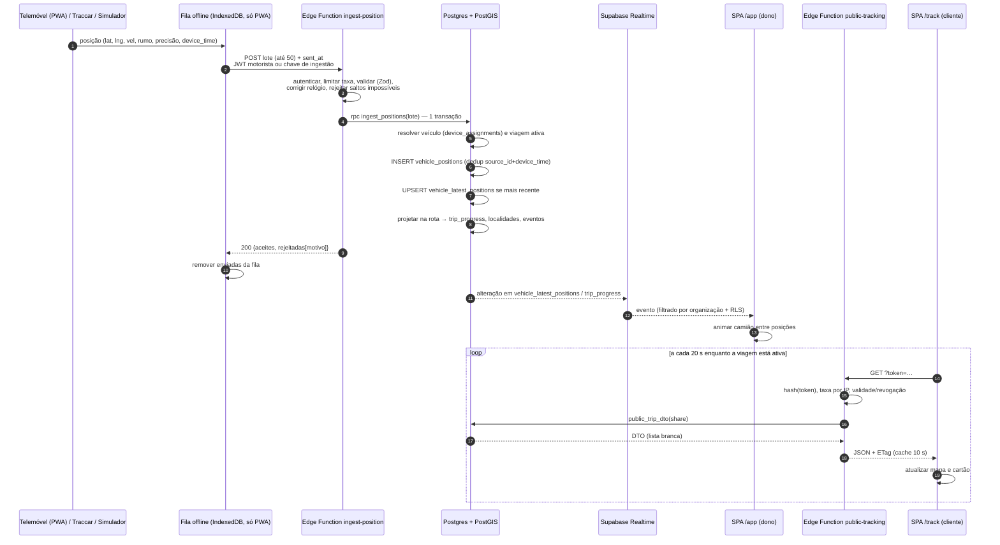
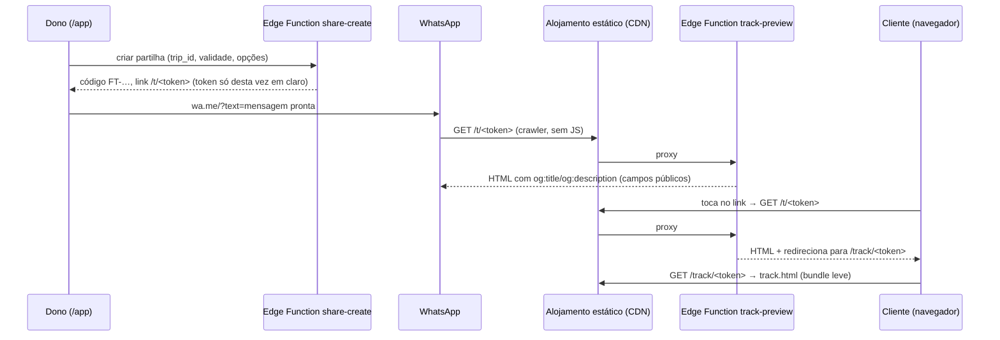
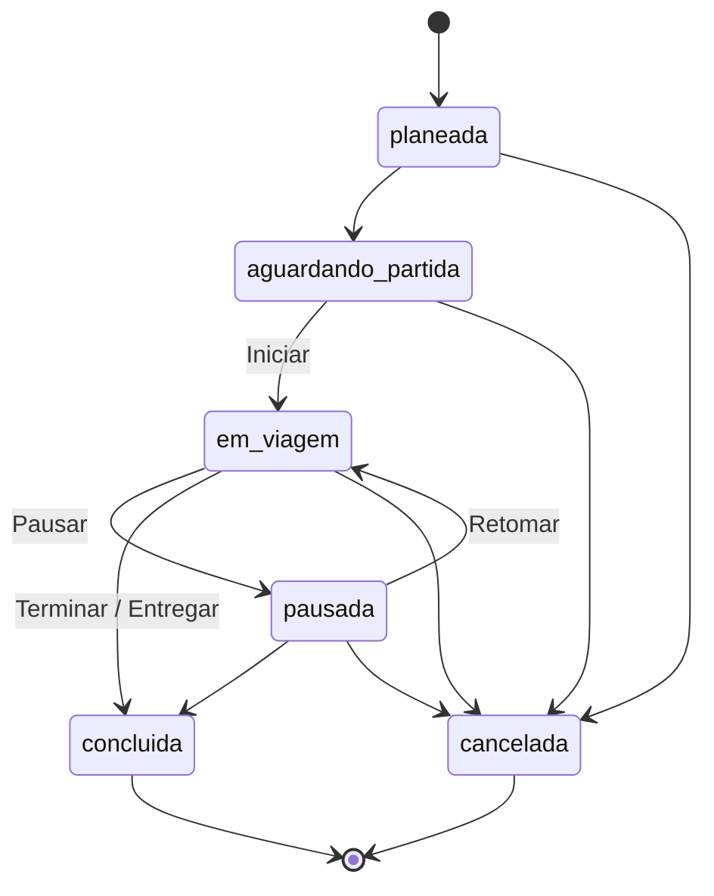

# Fluxos

## 1. Proprietário / Admin
1. **Registo** (`/register`): nome, e-mail, palavra-passe, nome da empresa, telefone → confirma e-mail → organização criada, papel `owner`, plano `trial`.
2. **Primeira configuração guiada** (checklist no dashboard vazio): adicionar camião → adicionar motorista → (opcional) associar GPS físico → criar primeira viagem.
3. **Convidar membros** (`/app/settings/membros`): e-mail + papel → convite com validade 7 dias.
4. **Criar viagem** (`/app/trips/nova`): camião, motorista, origem/destino (pesquisa em `places` com variantes de grafia, ou marcar no mapa), paragens, datas, carga, destinatário → o sistema mostra de imediato distância rodoviária, duração e o "horário de comboio" das localidades (de `route_cache` se existir) → gravar → estado `planeada`.
5. **Partilhar com o cliente**: botão "Partilhar com o cliente" → código `FT-…`, link `/t/…`, **Enviar por WhatsApp** (mensagem pronta), QR, validade → envio.
6. **Acompanhar**: dashboard / mapa ao vivo / detalhe da viagem; alertas; linha do tempo.
7. **Fechar**: viagem `concluida` (pelo motorista ou manualmente), comprovativo de entrega, custos da viagem.

## 2. Gestor / Despachante
Igual ao dono nas operações (criar e editar viagens, atribuir camião e motorista, partilhar, reconhecer alertas, registar custos de viagem), **sem** acesso a plano, membros, chaves de ingestão e eliminação definitiva. Cenário típico: vê o alerta "FT-4RW2-8HNA com atraso", liga ao motorista, regista ocorrência, ajusta a chegada prevista (registado em `trip_events`).

## 3. Motorista (PWA)
1. Recebe do dono, por WhatsApp, o link pessoal `/driver/entrar#token`.
2. Abre → escolhe/introduz PIN → aceita consentimento de localização (uma vez por versão) → "Adicionar ao ecrã principal".
3. Vê a viagem atribuída → **Iniciar viagem**: pede permissão de GPS, ativa Wake Lock, descarrega rota + localidades (+ tiles do corredor) → "Viagem iniciada" por voz.
4. Em viagem: indicador GPS/fila; avisos por voz; interface reduzida em movimento.
5. **Pausar/Retomar**, **Ocorrência** (tipo + foto), **Chegar a ponto**.
6. **Confirmar entrega**: foto, nome de quem recebeu, assinatura → **Terminar viagem**.
7. Sem rede: tudo continua localmente; posições e ações em fila (IndexedDB) com reenvio por ordem quando a rede volta.

## 4. Cliente final
1. Recebe por WhatsApp: "A sua carga está a caminho. Acompanhe aqui: https://…/t/q8Zt… (código FT-7K3M-9QXP)". O WhatsApp mostra a pré-visualização (via `track-preview`).
2. Toca no link → `/track/<token>` (bundle leve) → mapa + cartão (estado, %, km restantes, chegada prevista, localidades).
3. Alternativa: abre `/track`, escreve o código.
4. A página atualiza a cada 20 s. Após a entrega: "Entregue às 16:42", sem posição.
5. Se o link expirou/foi revogado: "Este link já não está disponível. Contacte a transportadora." (sem revelar se a viagem existe).

## 5. Admin da plataforma
1. Entra com conta marcada `is_platform_admin` → `/platform`.
2. Vê organizações, plano, utilização, limites; altera plano/limites (auditado).
3. **Acesso de suporte**: pede acesso a uma organização com motivo e duração (≤ 2 h) → registado em `audit_logs` e visível ao dono → só então vê dados operacionais.

## 6. Posição GPS: do dispositivo ao ecrã do cliente

## 7. Partilha e pré-visualização no WhatsApp (SPA pura)

## 8. Máquina de estados da viagem

