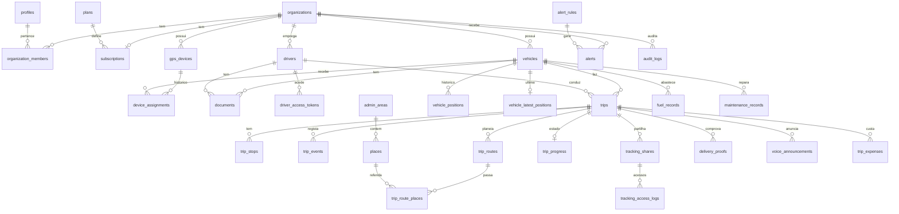

# Modelo de dados

> Postgres 15+ (Supabase) com PostGIS. Esquema `public` salvo indicação.
> Convenções: todas as tabelas têm `id uuid primary key default gen_random_uuid()`, `created_at timestamptz not null default now()`, `updated_at timestamptz not null default now()` (trigger `set_updated_at`). Tabelas privadas têm `organization_id uuid not null references organizations(id) on delete cascade`.
> Eliminação lógica (`deleted_at timestamptz`) em: `vehicles`, `drivers`, `trips`, `places` (privados), `gps_devices`. As restantes eliminam de facto (com auditoria quando sensível).
> Montantes: `numeric(14,2)` + `currency char(3) default 'MZN'`. Telefones: `text check (phone ~ '^\+[1-9][0-9]{7,14}$')`.
> Tokens (partilha, motorista, ingestão): guarda-se **só** o hash.

## 1. Diagrama ER (principal)

## 2. Tabelas

### 2.1 Conta e SaaS
| Tabela | Campos principais | Restrições / índices |
|---|---|---|
| `organizations` | name, slug, phone, province_id, timezone (`Africa/Maputo`), default_currency, settings `jsonb` (frescura, tolerância de atraso, intervalos GPS, alertas de documentos 30/15/7), branding (nome público, logo_path), deleted_at | `slug` único |
| `profiles` | id = `auth.users.id`, full_name, phone, locale (`pt-MZ`), is_platform_admin bool | PK = FK para `auth.users` on delete cascade |
| `organization_members` | organization_id, user_id, role `org_role` (`owner`,`admin`,`dispatcher`,`viewer`), invited_by, accepted_at | único (organization_id, user_id); trigger: ≥ 1 owner |
| `organization_invites` | organization_id, email, role, token_hash, expires_at, accepted_at | único (organization_id, email) onde não aceite |
| `plans` | code, name, limits `jsonb` (max_vehicles, max_devices, max_members, max_active_shares, retention_days), price, currency, is_public | `code` único |
| `subscriptions` | organization_id, plan_id, status (`trial`,`active`,`past_due`,`canceled`), period_start, period_end | único (organization_id) onde status ≠ canceled |
| `usage_counters` | organization_id, period (date, mês), positions_ingested, route_requests, public_views, sms_sent | único (organization_id, period) |

### 2.2 Frota
| Tabela | Campos principais | Restrições / índices |
|---|---|---|
| `vehicles` | plate, plate_normalized (gerada), make, model, year, body_type, capacity_t, gross_weight_t, length_m, width_m, height_m, axles, odometer_km, photo_path, admin_status (`ativo`,`em_manutencao`,`inativo`), gps_source_priority (`device`,`phone`), deleted_at | único (organization_id, plate_normalized) onde deleted_at is null; checks: year 1950–2100, dimensões > 0 |
| `drivers` | full_name, phone, photo_path, license_number, license_category, status (`ativo`,`inativo`), deleted_at | único (organization_id, phone) onde deleted_at is null |
| `documents` | vehicle_id **ou** driver_id, doc_type, number, issued_on, expires_on, file_path | `check (num_nonnulls(vehicle_id, driver_id) = 1)`; índice (organization_id, expires_on) |
| `driver_access_tokens` | driver_id, token_hash, pin_hash, device_fingerprint, failed_attempts, locked_until, last_used_at, revoked_at | único (token_hash); um ativo por motorista (índice parcial) |
| `driver_consents` | driver_id, consent_version, accepted_at, ip, user_agent | — |
| `gps_devices` | imei (**único global**), protocol, model, phone_number (SIM), traccar_device_id, last_contact_at, status, deleted_at | único (imei) |
| `device_assignments` | device_id, vehicle_id, valid_from, valid_to (null = atual) | `exclude using gist (device_id with =, tstzrange(valid_from, valid_to) with &&)` e o mesmo para vehicle_id+fonte (sem sobreposições) |
| `ingest_keys` | name, key_hash, scope (`traccar`,`simulator`), last_used_at, revoked_at | único (key_hash) |

### 2.3 Geografia e percurso
| Tabela | Campos principais | Restrições / índices |
|---|---|---|
| `geo_datasets` | name, source_url, license, retrieved_at, version | — |
| `admin_areas` | level (1 província, 2 distrito), name, code (pcode), parent_id, geom `geography(MultiPolygon)`, dataset_id | GIST(geom); único (level, code) |
| `places` | organization_id **null = público**, name, name_variants `text[]`, kind (`city`,`town`,`village`,`locality`,`bridge`,`toll`,`checkpoint`,`weighbridge`,`fuel`,`border`,`warehouse`,`customer`,`depot`,`workshop`), importance 1–5, province_id, district_id, geom `geography(Point)`, osm_id, dataset_id, deleted_at | GIST(geom); trigram em name e variantes (`pg_trgm`); check: privados não podem ter `osm_id` |
| `route_cache` | cache_key (hash), profile `jsonb`, geom `geography(LineString)`, cum_m `float8[]`, length_m, duration_s, roads `text[]`, validated_for_truck, data_version, hits, expires_at | único (cache_key) |
| `trip_routes` | trip_id, version, reason (`plan`,`deviation`,`edit`), geom, cum_m, length_m, duration_s, validated_for_truck, is_current | único (trip_id, version); único parcial (trip_id) onde is_current |
| `trip_route_places` | trip_route_id, place_id, seq, km_from_origin, eta, eta_confidence, passed_at, state (`proxima`,`atual`,`passada`) | único (trip_route_id, seq) |
| `trip_progress` | trip_id (PK), km_done, km_left, pct, current_place_id, current_label, province_id, next_place_id, eta_destination, eta_confidence, speed_kmh_smoothed, last_position_at, off_route_since | 1 linha por viagem; publicado em Realtime |
| `segment_speed_stats` | route_signature, segment_idx (10 km), p50_kmh, samples | — (dados agregados, partilhados entre organizações sem identificar ninguém) |
| `voice_announcements` | trip_id, idempotency_key, kind, text, triggered_at, km_at, played | único (trip_id, idempotency_key) |

### 2.4 Operação
| Tabela | Campos principais | Restrições / índices |
|---|---|---|
| `trips` | code (FT-…), vehicle_id, driver_id, origin_place_id, destination_place_id, status `trip_status`, planned_departure, planned_arrival, actual_departure, actual_arrival, cargo_description, cargo_weight_t, recipient_name, recipient_phone (**privados**), notes, cancel_reason, deleted_at | único (code); **único parcial** (vehicle_id) e (driver_id) onde status in (`em_viagem`,`pausada`); check planned_arrival > planned_departure |
| `trip_stops` | trip_id, seq, kind (`entrega`,`recolha`,`passagem`), place_id, recipient_name, recipient_phone, planned_at, arrived_at, departed_at | único (trip_id, seq) |
| `trip_events` | trip_id, kind, occurred_at, actor_type (`member`,`driver`,`system`), actor_id, payload `jsonb`, position `geography(Point)` | índice (trip_id, occurred_at) |
| `delivery_proofs` | trip_id, stop_id, received_by_name, signature_path, photo_paths `text[]`, delivered_at, position | — |
| `incidents` | trip_id, kind (`avaria`,`acidente`,`controlo_policial`,`estrada_cortada`,`outra`), note, photo_path, occurred_at, position, resolved_at | — |

### 2.5 Telemetria
| Tabela | Campos principais | Restrições / índices |
|---|---|---|
| `vehicle_positions` (**particionada por mês**, ADR-010) | organization_id, vehicle_id, trip_id, source (`device`,`phone`,`simulator`), source_id, device_time, sent_at, received_at, geom `geography(Point)`, speed_kmh, heading, accuracy_m, battery_pct, ignition, flags (`low_accuracy`,`clock_corrected`,`late`) | PK (id, device_time); único (source_id, device_time); índices (vehicle_id, device_time desc), (trip_id, device_time) parcial, BRIN(device_time) |
| `vehicle_latest_positions` | vehicle_id (PK), organization_id, source, device_time, received_at, geom, speed_kmh, heading, accuracy_m, trip_id | upsert só se `excluded.device_time > device_time`; Realtime |
| `ingest_rejections` | organization_id, source_id, reason, payload `jsonb`, received_at | retenção 30 dias |
| `trip_tracks` | trip_id (PK), geom simplificada, points_count | replay permanente |

### 2.6 Partilha
| Tabela | Campos principais | Restrições / índices |
|---|---|---|
| `tracking_shares` | trip_id, stop_id (opcional, L4), short_code, token_hash, expires_at, revoked_at, is_active, options `jsonb` (show_company, show_logo, show_plate_masked, show_driver_first_name), views_count, created_by | único (short_code), único (token_hash) |
| `tracking_access_logs` | share_id, accessed_at, ip_hash (sha256 + sal rotativo), user_agent, via (`code`,`link`,`preview`) | índice (share_id, accessed_at); retenção 90 dias |
| `public_rate_limits` | bucket_key, window_start, count | (usada pelas Edge Functions; sem acesso de clientes) |

### 2.7 Custos
| Tabela | Campos principais |
|---|---|
| `fuel_records` | vehicle_id, trip_id, filled_at, liters, amount, currency, odometer_km, station, full_tank bool, receipt_path |
| `maintenance_schedules` | vehicle_id, kind, every_km, every_days, last_done_at, last_done_km, next_due_at, next_due_km |
| `maintenance_records` | vehicle_id, schedule_id, kind, done_at, odometer_km, workshop, amount, currency, notes, receipt_path |
| `trip_expenses` | trip_id, category (`portagem`,`alimentacao`,`alojamento`,`reparacao`,`outra`), amount, currency, spent_at, note, receipt_path, created_by_driver_id |

Checks: `liters > 0`, `amount >= 0`, `odometer_km >= 0`.

### 2.8 Alertas, notificações e auditoria
| Tabela | Campos principais | Restrições |
|---|---|---|
| `alert_rules` | kind, enabled, params `jsonb` (N posições, corredor m, minutos…), severity | único (organization_id, kind) |
| `alerts` | rule_id, kind, vehicle_id, trip_id, driver_id, document_id, status (`aberto`,`reconhecido`,`resolvido`), opened_at, acknowledged_by, resolved_at, dedup_key, payload | **único parcial** (organization_id, dedup_key) onde status ≠ `resolvido` |
| `notification_channels` | kind (`in_app`,`web_push`,`email`,`sms`,`whatsapp`), config `jsonb`, enabled | — |
| `push_subscriptions` | user_id, endpoint, keys `jsonb` | único (endpoint) |
| `notifications` | user_id, alert_id, channel, title, body, sent_at, read_at, error | — |
| `audit_logs` | organization_id (null = plataforma), actor_type, actor_id, action, entity, entity_id, before `jsonb`, after `jsonb`, ip_hash, at | só INSERT (sem UPDATE/DELETE, nem para owners) |

## 3. Funções e vistas principais
- `is_member(org uuid, roles org_role[] default null) returns bool` — `SECURITY DEFINER`, `STABLE`, base de todas as políticas.
- `current_driver_id()` — lê o claim `driver_id` do JWT do motorista (ADR-008).
- `trip_transition(trip_id, to_status, reason)` — aplica a máquina de estados e grava `trip_events` + `audit_logs`.
- `ingest_positions(batch jsonb)` — chamada só pela `service_role` dentro de `ingest-position`; insere histórico, faz *upsert* condicional da última posição e atualiza `trip_progress`, tudo numa transação.
- `vehicle_status_v` — vista com o estado derivado (SPEC 6.3), `security_invoker = true` para respeitar RLS.
- `public_trip_dto(share_id)` — função usada **só** por `public-tracking` (service_role) que devolve o JSON com lista branca.

## 4. Resumo das políticas RLS

Todas as tabelas `public` têm `alter table … enable row level security` e **nenhuma** política para `anon`.

| Tabela(s) | SELECT | INSERT/UPDATE | DELETE |
|---|---|---|---|
| `organizations` | membros | owner/admin (UPDATE) | owner (via função com período de graça) |
| `organization_members`, `organization_invites` | membros | owner/admin | owner/admin (não o último owner) |
| `profiles` | o próprio + membros das mesmas organizações (nome) | o próprio | — |
| `plans` | autenticados | admin da plataforma | admin da plataforma |
| `subscriptions`, `usage_counters` | owner/admin | só service_role / plataforma | — |
| `vehicles`, `drivers`, `documents`, `gps_devices`, `device_assignments` | membros | owner/admin/dispatcher (`gps_devices`, `device_assignments`: owner/admin) | owner/admin (lógica) |
| `driver_access_tokens`, `ingest_keys` | owner/admin (sem colunas de hash expostas: vista) | owner/admin via função | owner/admin |
| `trips`, `trip_stops`, `trip_events`, `trip_routes`, `trip_route_places`, `trip_progress`, `incidents`, `delivery_proofs`, `voice_announcements` | membros; **motorista**: só linhas das viagens com `driver_id = current_driver_id()` | membros owner/admin/dispatcher; motorista só via funções (`trip_transition`, `report_incident`, `submit_delivery`) | owner/admin |
| `vehicle_positions`, `vehicle_latest_positions`, `trip_tracks` | membros | **só service_role** (ingestão) | só jobs de retenção |
| `places` | públicos (`organization_id is null`) para autenticados e motoristas; privados para membros | privados: owner/admin/dispatcher; públicos: só importação (service_role) | idem |
| `admin_areas`, `geo_datasets`, `route_cache`, `segment_speed_stats` | autenticados (dados não pessoais) | service_role | service_role |
| `tracking_shares` | membros (sem `token_hash`) | owner/admin/dispatcher via função (audita) | — (revogar = UPDATE) |
| `tracking_access_logs` | owner/admin/dispatcher | service_role | job de retenção |
| `fuel_records`, `maintenance_*`, `trip_expenses` | membros (para `viewer`, ver nota ¹); motorista: só despesas que criou | owner/admin/dispatcher; motorista INSERT de `trip_expenses` da sua viagem | owner/admin |
| `alert_rules`, `notification_channels` | membros | owner/admin | owner/admin |
| `alerts`, `notifications` | membros (notificações: só as do próprio utilizador) | service_role; UPDATE de estado por membros | — |
| `audit_logs` | owner/admin da organização; plataforma | só via trigger/funções | ninguém |
| `public_rate_limits`, `ingest_rejections` | ninguém (service_role) | service_role | service_role |

¹ Pergunta em aberto para o proprietário (ver resposta da Fase 0): o perfil `viewer` vê custos?

**Storage:** buckets privados `documents`, `vehicle-photos`, `driver-photos`, `delivery-proofs`, `receipts`, `org-branding`. Caminho `org/<organization_id>/…`; políticas em `storage.objects` verificam `is_member((storage.foldername(name))[2]::uuid)`. Acesso por URL assinada ≤ 5 min. O logótipo para a página pública é servido pela `public-tracking` com URL assinada de 1 h.

**Testes obrigatórios (Fase 1+):** para cada tabela privada, script com dois utilizadores reais de teste (org A e org B) que prova: B não lê, não insere com `organization_id` de A, não altera e não apaga linhas de A; `anon` não lê nada; motorista não vê viagens de outro motorista.
