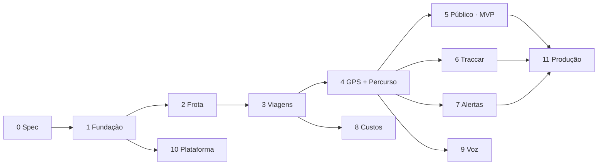

# Plano de fases

> Fatias verticais: cada fase entrega UI + BD + testes de uma funcionalidade. No fim de cada fase há relatório (formato do `CLAUDE.md`) e paragem para aprovação.
> Estimativa relativa: **P** (≤ 3 dias), **M** (1–2 semanas), **G** (> 2 semanas).
> Stack: **Vite puro** (SPA estática multi-entrada) + Supabase. Sem Next.js (ADR-000).

## Fase 0 — Especificação · P · ✅ entregue para aprovação
Documentos em `docs/`. Critério: aprovação escrita.

## Fase 1 — Fundação · M
**Tarefas**
- Scaffold **Vite + React + TS strict** com três entradas (`index.html`, `track.html`, `driver.html`) em `vite.config.ts`; Tailwind + shadcn/ui + Lucide; React Router; TanStack Query; RHF + Zod; ESLint + Prettier.
- Design system: tokens (incl. `warning`/`danger` com verificação de contraste), componentes base, layout com sidebar azul-marinho (desktop) e barra inferior (telemóvel), estados (a carregar, vazio, erro, sem ligação, desatualizado).
- `src/i18n/pt-MZ.ts`, `src/lib/format/` (MZN, datas `Africa/Maputo`, E.164), `src/lib/supabase/`, esqueleto `src/lib/map/` (`MapProvider` + MapLibre).
- Supabase local (`supabase init/start`), migrações: extensões (postgis, pg_trgm, pg_cron, btree_gist), `organizations`, `profiles`, `organization_members`, `organization_invites`, `plans`, `subscriptions`, `usage_counters`, `audit_logs`, `is_member()`, trigger `set_updated_at`.
- Auth: registo (cria organização), login, recuperação, convites, troca de organização.
- Testes RLS A↔B (scripts SQL/pgTAP com utilizadores reais de teste); Vitest; Playwright (fluxo de registo).
- CI (GitHub Actions): lint, typecheck, vitest, testes SQL contra Supabase local, build, verificação de que `track.html` não importa módulos de `/app`.
- Landing estática; Lighthouse ≥ 90. Seeds de desenvolvimento.
- Preencher a secção "Comandos" do `CLAUDE.md`.

**Dependências:** nenhuma. **Aceitação:** teste prova que a org A não vê/altera/apaga a org B; Lighthouse ≥ 90 na landing; CI verde.

## Fase 2 — Frota · M
Camiões, motoristas, documentos (bucket privado + URLs assinadas), fotografias, estado derivado (`vehicle_status_v`), alertas de validade calculados (30/15/7). **Depende de:** 1. **Aceitação:** CRUD completo com validação Zod no cliente e restrições na BD; estados vazio/erro; testes RLS para as tabelas novas; matrícula única por organização.

## Fase 3 — Viagens · M
Criar/editar viagens, paragens, `trip_transition()`, `trip_events`, linha do tempo, lista e histórico com filtros. Seleção de origem/destino ainda por `places` mínimo (importação completa na Fase 4). **Depende de:** 2. **Aceitação:** transições inválidas bloqueadas no backend (testes SQL); unicidade de viagem ativa por camião/motorista; linha do tempo correta.

## Fase 4 — GPS + Mapa ao vivo + Inteligência de percurso · G (a maior)
Sub-entregas (cada uma com relatório intermédio curto):
- 4a **Dados geográficos:** `tools/import-places` (HDX + OSM), `tools/build-tiles` (PMTiles), `geo_datasets`. · M
- 4b **Rotas:** Valhalla em Docker, Edge Function `route-plan`, `route_cache`, `trip_routes`, `trip_route_places`, ferramenta "Distâncias". · M
- 4c **Ingestão:** `ingest-position`, `ingest_positions()`, partições + pg_cron, `vehicle_latest_positions`, `ingest_rejections`, limitação de taxa. · M
- 4d **Simulador** `tools/gps-simulator` (Node CLI): reproduz rotas do Valhalla com velocidade variável, paragens, perda de sinal, ruído, relógio errado; cenários gravados para testes. · M
- 4e **Progresso:** `src/lib/geo/progress.ts` (TS puro) + atualização de `trip_progress` no servidor; ETA com confiança; teste de equivalência TS ↔ PostGIS. · M
- 4f **Mapa ao vivo e detalhe de viagem** com Realtime e animação suave. · M
- 4g **PWA do motorista:** login link+PIN (`driver-session`), viagem atual, botões, fila offline IndexedDB, Wake Lock, descarga do corredor, avisos por voz básicos, teste de voz sem rede em aparelhos reais. · G

**Depende de:** 3. **Aceitação:** simulador Quelimane→Beira move o camião em tempo real; km percorridos + restantes = comprimento ± 1 %; localidades na ordem certa; avisos por voz na ordem esperada e sem repetições (com ruído e perda de sinal); funciona sem rede (teste Playwright com rede desligada + teste manual em telemóvel). ⚠️ Dependências: VPS para Valhalla, R2 para tiles.

## Fase 5 — Rastreamento público · M · **fim do MVP vendável**
`tracking_shares`, `share-create`, `public-tracking`, `track-preview` (OG), página `/track` e `/track/:token` (bundle separado), QR (PNG), botão WhatsApp, validade/revogação/regeneração, contagem de acessos, privacidade após entrega. **Depende de:** 4. **Aceitação:** teste prova que o DTO só contém campos da lista branca; limitação de taxa funciona; sem posição após entrega; bundle `/track` dentro do orçamento (RNF-2); pré-visualização OG validada.

## Fase 6 — Traccar + hardware · M
Traccar em Docker, encaminhamento de posições para `ingest-position` (mecanismo exato a confirmar na documentação da versão instalada ⚠️), `gps_devices`, associação por IMEI, `device_assignments`, estado de comunicação, simulador de protocolo. **Aceitação:** `TESTADO` com simulador de protocolo; `VALIDADO` só com equipamento real (plano em `RISCOS-E-CUSTOS.md` §4).

## Fase 7 — Alertas e notificações · M
`alert_rules`, motor de alertas (no fluxo de ingestão + jobs pg_cron), estados aberto/reconhecido/resolvido, push web, preferências. **Aceitação:** trajetos simulados de desvio real vs ruído GPS sem falsos positivos; um alerta por episódio.

## Fase 8 — Custos e relatórios · M
Combustível, manutenção (por data/km), despesas de viagem com recibos, relatórios por camião/viagem/período, exportação CSV. **Aceitação:** totais corretos e testados; consumo L/100 km correto entre abastecimentos cheios.

## Fase 9 — Assistente de voz · M
Botão "Falar", reconhecimento de voz (suporte em pt nos Android a verificar e documentar ⚠️), intenções locais, respostas só com dados calculados. **Aceitação:** teste prova que nunca responde com dados inexistentes.

## Fase 10 — Plataforma SaaS · M
`/platform`, planos, limites aplicados no backend, utilização, acesso de suporte auditado. **Aceitação:** exceder um limite é bloqueado pela BD/Edge Function, não só pela UI.

## Fase 11 — Produção · M
Testes de carga da ingestão (RNF-6), revisão de segurança, backups e teste de restauro, monitorização, domínio, política de privacidade, documentação de utilizador. **Aceitação:** checklist de produção cumprida.

## Dependências entre fases


## Comandos previstos (a confirmar na Fase 1)
```
npm run dev        # vite
npm run build      # vite build (3 entradas estáticas)
npm run preview    # vite preview
npm test           # vitest
npm run e2e        # playwright
supabase start     # stack local
supabase db reset  # migrações + seed
npm run db:types   # supabase gen types typescript --local
npm run db:test    # testes RLS/SQL
npm run sim -- --route quelimane-beira --speed 10x
```
